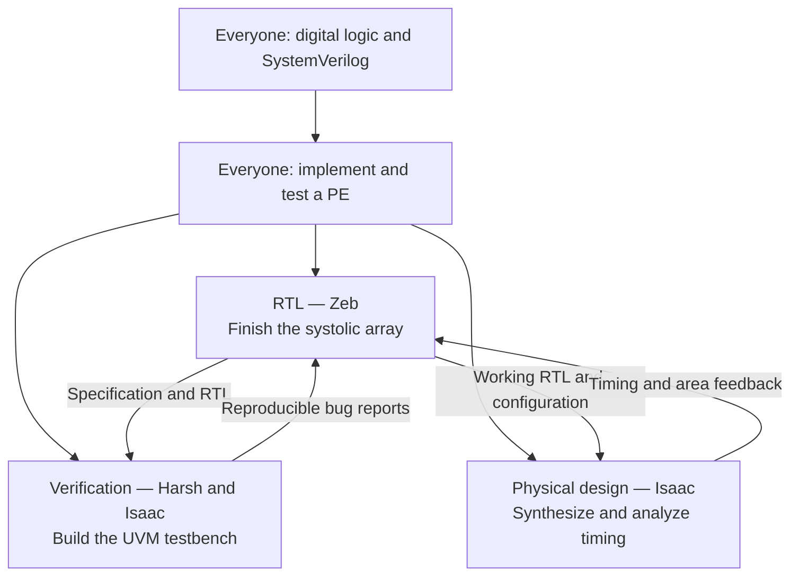
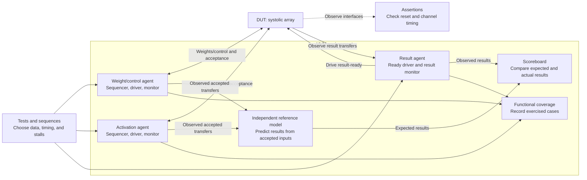

# Silicon Badgers technical projects

Everyone starts by writing a processing element (PE) in SystemVerilog. After the
shared introduction, split into RTL, verification, or physical design (PD).
The teams work toward the same goal: a working systolic array, tests that catch
its bugs, and evidence that the design can meet an agreed timing and area target.

[Project plan](#project-plan) · [Start here](#start-here) ·
[Checkpoints](#completion-checkpoints) · [Automation](#automation-and-independent-work) ·
[Lead edits](#edits-for-the-track-leads)

## Project plan



Zeb is finishing the RTL systolic array. Harsh and Isaac own the verification
plan and UVM block diagram. Isaac owns the PD plan and implementation flow.
These are the leads responsible for finishing the track material and coordinating
the work; members implement the exercises and contribute within their track.

### Everyone: implement a PE

Complete the [shared introduction](intro/README.md), implement the PE against its
[specification](intro/projects/processing-element/spec/pe.md), and pass the
[PE checkpoint](intro/README.md#pe-checkpoint). This includes members heading into
verification and PD: everyone needs to understand the hardware they will test or
implement. Keep the supplied acceptance testbench unchanged for the checkpoint.

### RTL: build the full systolic array

**Lead: Zeb.** Connect the PEs, first demonstrate a 2×2 matrix product, then finish
the array's dimensions, operand scheduling, input buffering, control, and output
handling. The [RTL guide](rtl/README.md) describes the sequence and its two
checkpoints.

The handoff is the RTL, an editable hardware block diagram, one shared interface
and behavior specification, and a small working simulation. Record dimensions,
signed arithmetic and overflow, reset, accepted transfers, and when results are
complete. Harsh and Isaac use that contract to build their testbench; Isaac uses
the same RTL revision and configuration for synthesis.

### Verification: draw the testbench, then build it

**Leads: Harsh and Isaac.** Start with a UVM (Universal Verification Methodology)
block diagram and a test plan. The diagram explains who generates inputs, who
observes transfers, and who checks the answers. The plan maps each requirement to
a test, a checker, and a coverage goal.

[The UVM course in PR #4](https://github.com/SiliconBadgers/technical-projects/pull/4)
provides the learning sequence: a synchronous FIFO, an APB register block, then a
systolic array. Use those smaller projects to learn the components before
assembling the array environment. The course uses supplied designs and hidden
bug variants; integrating Zeb's array is the next shared handoff.

This starting diagram follows the course array's weight/control, activation,
and result channels. Harsh and Isaac will edit it to match the agreed RTL interface:



The model also tracks reset and configuration changes so it discards canceled
work and predicts the right arithmetic. The result agent drives backpressure and
observes the design's output; the scoreboard checks values, ordering, and missing
or duplicate results. Coverage records which planned situations actually occur.

Build directed tests first, then reproducible random tests. Cover reset/restart,
signed boundaries and overflow, consecutive operations, and stalls supported by
the interface. Demonstrate that the environment passes a correct design and
fails representative broken designs. Deliver the diagram, test plan, testbench,
regression command, coverage summary, and reproducible bug reports.

The course array has a different interface from the shared PE, which has no
backpressure input. Zeb, Harsh, and Isaac must agree on the array interface,
reset rules, arithmetic, and any adapter before connecting the two projects.

### Physical design: turn working RTL into gates

**Lead: Isaac.** Begin with [the synthesis course in PR #7](https://github.com/SiliconBadgers/technical-projects/pull/7):
learn the cell library, run the reference designs, then work through the
accelerator-tile lab. This lets PD start while Zeb finishes the array.

For the shared array, the first deliverable is a reproducible synthesis and timing
study:

1. Select the RTL revision, top module, dimensions, library, and tool flow.
2. Write timing constraints: the clock target, input arrival times, and output
   requirements. Check that all intended paths are constrained.
3. Synthesize the RTL into gates and report cell area and timing. Explain the
   critical path: the path that limits the clock speed.
4. Check that the synthesized design preserves the RTL's behavior using
   equivalence checking and the flow's gate-level tests.
5. Try a justified improvement, compare the same configuration before and after,
   and send any RTL changes back through Zeb and verification.

Keep the scripts, constraints, and a short results report together. Include exact
commands, tool/library versions, timing corner, and unresolved failures. The
course's accelerator tile is a teaching design; record the separate handoff when
the flow is run on Zeb's array.

Floorplanning, placement, clock-tree synthesis, routing, and checks on the routed
layout are a later extension for Isaac to scope. The initial target is synthesis
and timing; a synthesis report alone does not establish routed timing or tapeout
readiness.

## Where the work lives

- `intro/`: common setup, lessons, PE specification, starter RTL, and acceptance tests.
- `rtl/`: systolic-array specification, hardware diagrams, RTL, and design smoke tests.
- `verif/`: UVM diagrams, test plans, testbenches, reference models, coverage, and regressions.
- `pd/`: synthesis lessons, constraints, flows, and physical-design results, introduced by PR #7.
- `scripts/` and `.github/workflows/`: shared checks and automation.

The guides below describe what is on `main` now. PR #4 expands verification and
PR #7 adds PD; use those PRs for the incoming course material. Keep one shared
array contract and reference the RTL instead of maintaining separate copies for
the integrated design.

## Start here

| Read | What is there |
| --- | --- |
| **[CAE setup](intro/SETUP.md)** | Connect, get the repository, run VCS, and view waveforms. |
| **[Shared introduction](intro/README.md)** | Digital logic, waveform exercises, SystemVerilog, and the PE project. |
| **[RTL track](rtl/README.md)** | Build the systolic array design. |
| **[Verification track](verif/README.md)** | Develop tests, follow the verification plan, and complete the testbench. |

Each page has a short contents list for jumping between sections. Links to code
open the relevant file and line range.

## First run

Follow [CAE setup](intro/SETUP.md), then run from the repository root on CAE:

```sh
make check
module load synopsys/suite
synopsys-run
make smoke
```

`make day1` simulates the supplied gates, full adder, mux, and slide 21 waveform
expressions, checks their outputs, and writes `build/day1/waves.vcd` for viewing
in GTKWave.

`make pe` runs processing element (PE) testbench;
the template RTL is expected to fail until you implement it.

## Completion checkpoints

Exercises between these milestones are self-paced practice.

| Checkpoint | Applies to | Completion check |
| --- | --- | --- |
| [PE](intro/README.md#pe-checkpoint) | Shared introduction | The PE passes all seven configurations of the supplied acceptance suite. |
| [Matmul](rtl/README.md#matmul-checkpoint) | RTL | The 2×2 implementation computes complete matrix products correctly. |
| [Systolic array](rtl/README.md#systolic-array-checkpoint) | RTL | The completed array handles the agreed configurations and control behavior. |
| [Testbench completion](verif/README.md#testbench-completion) | Verification | The completed testbench checks requirements and detects design errors. |

The array and extended testbench are still planned; their guides describe what
to build next. PD's incoming course defines its own lab deliverables. The four
checkpoints above stay in place while that course is reviewed.

## Automation and independent work

The existing GitHub Actions workflow checks documentation links, regenerates
guide images, and simulates the completed introductory examples. We will build
on that with these proposed checks:

- **PE checkpoint:** run the submitted PE against a maintainer-controlled
  acceptance suite, verify all seven configurations complete, and attach the
  tested commit, seed, results, and log. Keep this separate from course CI so
  the intentionally unfinished starter can remain on `main`.
- **Track regressions:** run array tests, UVM regressions, and PD checks as each
  track's commands become stable. Fail on errors, timeouts, or missing expected
  activity. Report unrun checks explicitly.
- **Review routing:** use path-based review requests for RTL, verification, and
  PD once the leads' GitHub accounts and repository access are confirmed.

The [automation plan](CONTRIBUTING.md#automation-plan) describes the implementation
order and what each bot checks. These additional bots are follow-up work.

For assessed exercises, the proposed rule is to write your RTL, testbench,
constraints, and explanation yourself; generated solutions do not count as your
work. Cite outside help, including AI use. Keep practice and concept questions
open, and explain any borrowed idea you use. Automated tests check behavior;
mentor review establishes whether you understand the implementation. An
AI-detector score will not be a completion criterion.

### Optional pilot: project code-review interviews

Try a 10–15 minute review when a member finishes the technical project. Walk
through their code, trace one example, and make or debug a small change without
AI assistance. Use questions from their own work:

- **PE / RTL:** trace a bubble or reset, explain signed widths, or fix an operand-alignment bug.
- **Verification:** explain a checker, identify a coverage gap, or add a test that catches a seeded bug.
- **PD:** explain a timing path, justify a constraint, or compare two synthesis results.

The reviewer gives concrete feedback and a follow-up opportunity. This is a
proposal for a pilot, not an additional required checkpoint. If adopted, attach
the conversation to the existing completion review.

## Edits for the track leads

- **Zeb:** finish the RTL systolic-array material and hardware diagram; identify
  the shared interface, runnable example, and handoff configuration.
- **Harsh and Isaac:** revise the UVM diagram and verification plan, connect them
  to the course in PR #4, and define the tests and coverage needed for the array.
- **Isaac:** refine the PD plan around PR #7, choose the initial tool/library
  target, and define the synthesis/timing handoff and later place-and-route scope.
- **All three:** agree on the array contract and review criteria, then decide
  whether to pilot interviews and who implements each automation task.

For repository changes, see [Contributing](CONTRIBUTING.md).
