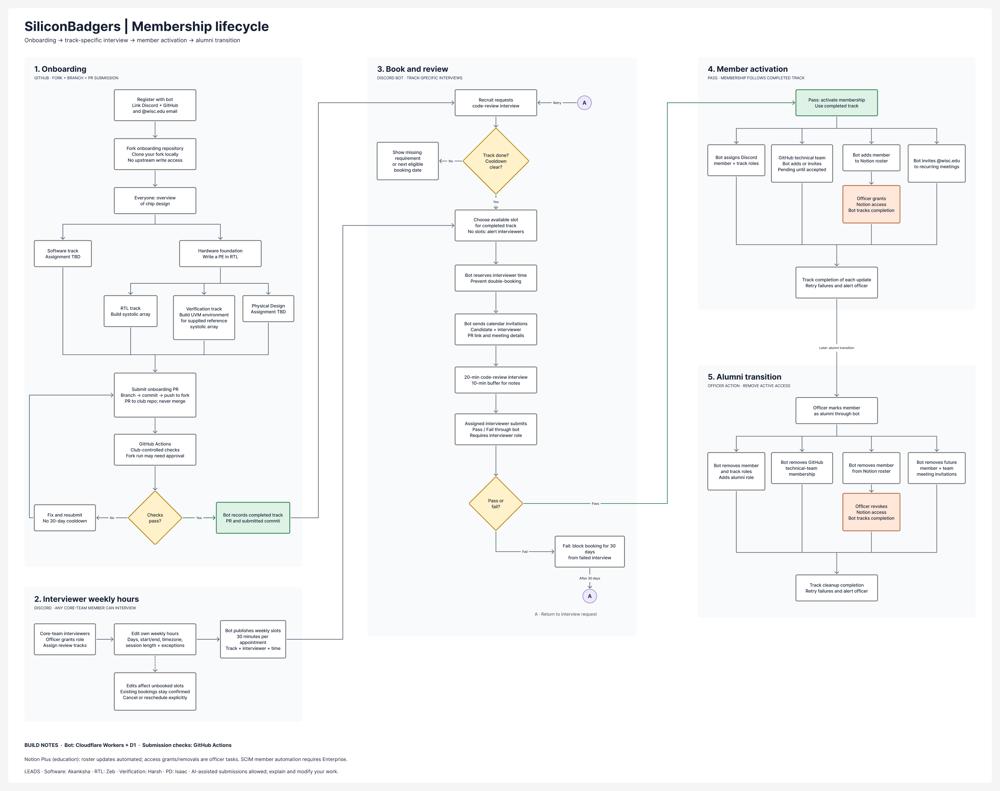

# SiliconBadgers technical projects

Start with a shared overview of chip design, then complete the onboarding for
your subteam. Software branches after the overview. RTL, verification, and
physical design (PD) continue through a shared processing element (PE) exercise
before splitting into their own projects.

This PR defines the onboarding and membership workflow for the leads to review.
The course material is available below; the submission, scheduling, and membership
bot is follow-up implementation work.

[Project plan](#project-plan) · [Submissions](#submit-your-onboarding-work) ·
[Interviews](#code-review-interviews) · [Membership](#membership-and-alumni) ·
[Lead review](#edits-for-the-track-leads) · [Start here](#start-here)

## Project plan

[Open the editable FigJam: onboarding, interviews, membership, and alumni](https://www.figma.com/board/nALl7dSIj8mFu1q497dpR0/SiliconBadgers-Membership-Lifecycle?node-id=4-237).

[](https://www.figma.com/board/nALl7dSIj8mFu1q497dpR0/SiliconBadgers-Membership-Lifecycle?node-id=4-237)

The image is a snapshot of the editable board. Keep it and this plan aligned when
the leads settle the remaining curriculum details.

| Track | Lead | After the shared overview | Decisions for the lead |
| --- | --- | --- | --- |
| Software | **Akanksha** | Branch directly into software onboarding. | Project, learning sequence, tools, deliverables, checks, and interview rubric. |
| RTL | **Zeb** | Implement the PE, then build a systolic array. | Required array scope, interface, reference configuration, acceptance tests, and rubric. |
| Verification | **Harsh** | Implement the PE, then build a UVM environment for a supplied reference systolic array. | Required preparatory labs, reference design/revision, test plan, coverage and bug-detection criteria, and rubric. |
| Physical design | **Isaac** | Implement the PE, then complete a PD assignment. | Required course subset, target design, tools/library, constraints and reports, completion criteria, and rubric. |

### Shared overview and hardware foundation

Everyone gets the overview of how a chip is designed and how the subteams fit
together. The leads need to identify the exact common material so software
members have a clear point to branch off.

RTL, verification, and PD members then follow the [shared introduction](intro/README.md),
implement the PE against its [specification](intro/projects/processing-element/spec/pe.md),
and complete the [PE checkpoint](intro/README.md#pe-checkpoint). Keep the supplied
acceptance testbench unchanged. Software members do not need to implement the PE.

### Software: define the onboarding project

**Akanksha:** define what a new member learns, builds, submits, and demonstrates
after the overview. Choose an achievable project, its prerequisites, expected
effort, and reproducible checks. The assignment and its repository location
remain to be defined.

### RTL: build the full systolic array

**Zeb:** the [RTL guide](rtl/README.md) starts with a 2×2 matrix product and
continues through array dimensions, operand scheduling, input buffering,
control, and output handling. Specify which milestones complete onboarding.

Finish the hardware diagram and interface contract: dimensions, signed
arithmetic, overflow, reset, accepted transfers, and result completion. Publish
the reference configuration and acceptance checks so another core-team member
can assess the project consistently.

### Verification: build an environment for a supplied array

**Harsh:** the [UVM course](verif/README.md) contains FIFO, APB, and
[systolic-array](verif/projects/systolic_array/README.md) projects. Identify which
labs are onboarding requirements and which are further practice. The full
course's duration is not automatically the onboarding requirement.

The target is a UVM (Universal Verification Methodology) environment for a
supplied reference array. A verification recruit does not have to implement the
full array or wait for another recruit's RTL. Pin the design and specification,
then define the agents, independent reference model, scoreboard, assertions,
coverage goals, and tests that demonstrate meaningful bug detection.

Provide a testbench block diagram, test plan, and reproducible regression against
both a correct design and representative broken versions. Integrating student
RTL is a later collaboration: Zeb and Harsh must agree on the interface and
revision first. The course array and shared PE have different interfaces.

### Physical design: scope the onboarding assignment

**Isaac:** the [PD area](pd/README.md) includes a [synthesis course](pd/synth/README.md)
covering libraries, synthesis, timing constraints and analysis, equivalence
checking, and gate-level simulation. Propose the onboarding subset and expected
effort using that material.

Confirm the target design/revision, tool and library access, required scripts and
reports, and measurable completion criteria. Clarify whether onboarding ends at
synthesis and timing or includes any place-and-route work. The entire six-week
course is not automatically required.

## Submit your onboarding work

1. Fork the onboarding repository, clone your fork, and work on your own branch
   on your computer or CAE. Follow the [setup guide](intro/SETUP.md).
2. Commit, push to your fork, and open a PR into the club repository. Include
   your track, completed work, reproduction instructions, known failures, and
   outside help. Exercise submissions are reviewed and closed without merging
   solutions into the course.
3. In the bot workflow, link your Discord account, GitHub identity, and
   `@wisc.edu` email, then submit the PR through the bot. It validates ownership,
   track, and the exact submitted commit and requests club-controlled checks.
4. Passing checks establish eligibility for that track's interview. Failed checks
   mean fix and resubmit; they do not start the interview cooldown. A new commit
   requires a new check result.

A public repository needs no write-access invitation for this fork workflow.
A private organization repository needs read access and forking enabled.
Fork-triggered Actions can require [maintainer approval](https://docs.github.com/en/actions/how-tos/manage-workflow-runs/approve-runs-from-forks).
Passing the existing course CI alone does not establish onboarding completion.

## Code-review interviews

After completing onboarding, book through the Discord bot for that same track.
Passing activates membership in the completed track; there is no second
subteam-choice step after the interview.

### Interviewers and workload

**Any core-team member can give code-review interviews.** An officer grants the
Discord `interviewer` role and records the tracks the person can assess using
the lead's rubric. Leads define the curriculum and help with difficult cases;
they do not have to conduct every interview.

Use **20 minutes for the review plus a 10-minute buffer** for notes and turnover.
One assigned interviewer handles each appointment. Sharing sessions across the
core team and booking only offered hours bounds the workload by each person's
availability.

Interviewers edit their recurring weekly hours through the bot: weekdays,
start/end times, timezone, and date-specific exceptions. It offers 30-minute
slots for the matching track, checks eligibility and cooldown, and prevents
double-booking the interviewer or candidate. Calendar invitations include the
PR, submitted commit, and meeting details.

Weekly-hours edits affect unbooked slots; existing appointments stay confirmed
until explicitly canceled or rescheduled. If no slots are available, the bot
alerts the interviewer pool. It does not assign extra sessions outside their hours.

### Understanding, AI assistance, and the result

Review the member's work: explain a design choice, trace an example, interpret
a result, and make or debug a small change. Each lead supplies a short rubric
and examples of passing work so core-team interviewers can apply the same standard.

**AI-assisted solutions are allowed.** Members must understand, explain, test,
and modify what they submit. Describe meaningful AI assistance and other outside
help in the PR. Assess demonstrated understanding, not an AI-detector score.

Only the assigned interviewer with the `interviewer` role records pass/fail
through the bot. A failed interview includes feedback and blocks another booking
for **30 days from the failed interview**. Afterward, the member can book another
review for the same track. Cancellation and no-show rules need agreement before
launch; neither silently counts as a failed technical review.

## Membership and alumni

| System | After passing | When an officer marks the member as alumni |
| --- | --- | --- |
| Discord | Add member and completed-track roles. | Remove active member/track roles; add alumni. |
| GitHub | Add/invite to the technical team; track acceptance. | Remove technical-team membership or cancel its pending invitation. |
| Notion roster | Add the membership record. | Remove the active roster entry. |
| Notion access | Create and track an officer task to grant access. | Create and track an officer task to revoke access. |
| Google Calendar | Invite the `@wisc.edu` address to applicable recurring member/subteam meetings. | Remove future member/subteam meeting invitations. |

The workspace uses Notion Plus through the education offer. Roster data can be
updated through the API; automated workspace-member provisioning through
[SCIM requires Enterprise](https://www.notion.com/help/provision-users-and-groups-with-scim).
Access changes remain officer tasks. Both the roster and access must be handled
when someone becomes alumni.

Track each update separately, retry failures, and alert an officer when needed.
Pending invitations and incomplete access tasks remain visible until completed.

## Edits for the track leads

**Akanksha, Zeb, Harsh, and Isaac: please each review your onboarding track and
the complete FigJam workflow.** Edit the plan or leave concrete suggested changes:

1. Do you agree with the path and common overview/PE split? What would you change?
2. What exactly must a recruit complete before booking? Separate required work
   from optional practice and estimate the effort.
3. What is supplied, what does the recruit write, and what tools/access are needed?
   Identify the reference design, interface, and course dependencies.
4. What checks and evidence establish completion, and what is the interview rubric?
5. Can another core-team member assess it in 20 minutes? Provide example questions,
   pass/fail guidance, and any preparation the interviewer needs.
6. Does the submission, booking, 30-day retry, activation, and alumni plan work
   for your team? Flag anything missing or unnecessarily difficult.

Before rollout, assign the bot/service-account owner, agree on cancellation and
no-show rules, and confirm the exact roles, GitHub team, roster, and calendars.
Resolve these implementation details in the PR review.

## Start here

| Read | What is there |
| --- | --- |
| [CAE setup](intro/SETUP.md) | Fork/clone setup, VCS, UVM, and waveform viewing. |
| [Shared introduction](intro/README.md) | Digital logic, SystemVerilog, and the hardware PE project. |
| [RTL track](rtl/README.md) | Matrix multiplication and systolic-array design. |
| [Verification track](verif/README.md) | Supplied-design UVM course, tests, and coverage. |
| [Physical design](pd/README.md) | Synthesis, constraints, timing, and tool setup. |
| [Software plan](#software-define-the-onboarding-project) | Decisions for Akanksha before the assignment is published. |

For the hardware introduction, follow setup, then run from the repository root
on CAE:

```sh
make check
module load synopsys/suite
synopsys-run
make smoke
```

`make day1` simulates the completed digital-logic examples and writes
`build/day1/waves.vcd`. `make pe` runs the PE acceptance suite; the starter fails
until you implement it.

## Completion checkpoints

The existing course checkpoints remain in place. Intermediate exercises stay
self-paced practice. The membership interview happens after the required track
work, rather than after every exercise.

| Checkpoint | Applies to | Completion check |
| --- | --- | --- |
| [PE](intro/README.md#pe-checkpoint) | RTL, verification, and PD foundation | All seven configurations of the supplied acceptance suite pass. |
| [Matmul](rtl/README.md#matmul-checkpoint) | RTL | The 2×2 implementation computes complete matrix products correctly. |
| [Systolic array](rtl/README.md#systolic-array-checkpoint) | RTL | The array handles the agreed configurations and control behavior. |
| [Testbench completion](verif/README.md#testbench-completion) | Verification | The testbench checks the specification and detects design errors. |

Software's assignment and the required PD subset will be defined by their leads.
See [Contributing](CONTRIBUTING.md) for file placement and the
[automation implementation plan](CONTRIBUTING.md#automation-plan).
