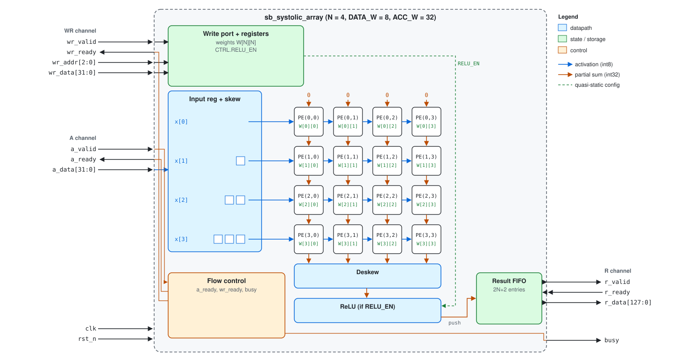

# `sb_systolic_array` Specification

Version 1.0 (2025-09-06). RTL: `rtl/sb_systolic_array.sv`. Ports and handshake rules: [`interface.md`](interface.md). Example waveforms: [`cycle_tables.md`](cycle_tables.md).

## 1. Summary

An N × N weight-stationary systolic array for signed 8-bit integers. The host loads a weight matrix `W`, then sends activation vectors `x`. For each accepted `x`, the array returns `y = x · W` (N signed 32-bit values), in order, with optional ReLU.

## 2. Block diagram



## 3. Parameters

| Parameter | Default | Valid range | Description |
|---|---|---|---|
| `N` | 4 | ≥ 2 | Array dimension |
| `DATA_W` | 8 | 8 | Activation and weight width (signed) |
| `ACC_W` | 32 | ≥ 2·DATA_W + ⌈log2 N⌉ | Result element width (signed) |

Out-of-range `N` or `ACC_W` stops elaboration with `$error`.

| Derived | Value (N = 4) |
|---|---|
| `ADDR_W` = ⌈log2(N+1)⌉ | 3 |
| `LATENCY` = 2N+1 | 9 |
| `DEPTH` = 2N+2 | 10 |

## 4. Clock and reset

| Signal | Description |
|---|---|
| `clk` | All ports are synchronous to the rising edge. |
| `rst_n` | Active low. Asynchronous assert, synchronous deassert. |

An *edge* is a rising edge of `clk`. "X at edge *c*" means the value of X sampled at edge *c*. A *transfer* on a channel happens at an edge where its `valid` and `ready` are both 1.

## 5. Interfaces

| Channel | Ports | Direction of data |
|---|---|---|
| WR | `wr_valid`, `wr_ready`, `wr_addr`, `wr_data` | host → DUT (register writes) |
| A | `a_valid`, `a_ready`, `a_data` | host → DUT (activation vectors) |
| R | `r_valid`, `r_ready`, `r_data` | DUT → host (result vectors) |
| Status | `busy` | DUT → host |

Details are in [`interface.md`](interface.md).

## 6. Register map

Registers are write-only, written through the WR channel.

| Address | Register | Reset | Description |
|---|---|---|---|
| `0 .. N-1` | `WROW[m]` | 0 | `W[m][n] = wr_data[8n+7:8n]`, signed |
| `N` | `CTRL` | 0 | Bit 0 `RELU_EN`; other bits ignored |
| `N+1 ..` | — | — | Reserved; write accepted, no effect |

## 7. Function

### Programming model

1. Reset.
2. Write weight rows 0 … N-1.
3. Optionally write `CTRL`.
4. Send activation vectors on A; take results on R.
5. The block is idle when `busy` is 0.

### Operation

**Computation.** For each accepted `x`:

```
y[n] = Σ_m x[m] · W[m][n]          (exact, signed)
y[n] = max(y[n], 0)                if RELU_EN = 1
```

`W` and `RELU_EN` are the values written at edges before the activation's transfer.

**Outstanding results.** outstanding(c) = A transfers before edge *c* − R transfers before edge *c*, counted since reset.

**A channel.** `a_ready` = 1 iff outstanding(c) < DEPTH.

**WR channel.** `wr_ready` = 1 iff there was no A transfer at edges *c*−2N … *c*−1 and there is none at edge *c*.

**R channel.** `r_valid` = 1 iff (A transfers at edges ≤ *c* − LATENCY) > (R transfers before edge *c*).

**Status.** `busy` = 1 iff outstanding(c) > 0.

**Reset.**
- While `rst_n` = 0, all results in flight are discarded and `W` and `RELU_EN` are cleared.
- `a_ready` and `wr_ready` are 0 while `rst_n` = 0, and at the first edge after it rises.
- `r_valid` and `busy` are 0 while `rst_n` = 0.

### Timing

| Operation | Value |
|---|---|
| A transfer → result available | LATENCY edges |
| Throughput | 1 vector per edge while `r_ready` = 1 |
| Write takes effect | For activations transferred at later edges |

## 8. Requirements

| ID | Requirement |
|---|---|
| R01 | `a_ready` and `wr_ready` shall be 0 at every edge where `rst_n` is 0, and at the first edge where `rst_n` is 1 again. |
| R02 | `r_valid` and `busy` shall be 0 at every edge where `rst_n` is 0. |
| R03 | No result for an activation transferred before a reset shall be delivered after it. |
| R04 | After reset, every `W[m][n]` and `RELU_EN` shall be 0 until written. |
| R05 | A write shall take effect once for every edge where `wr_valid` and `wr_ready` are both 1. |
| R06 | A write to address `m` < N shall set `W[m][n] = wr_data[8n+7:8n]` for every n and change nothing else. |
| R07 | A write to address N shall set `RELU_EN = wr_data[0]` and change nothing else. |
| R08 | A write to an address above N shall complete a handshake and change nothing. |
| R09 | `wr_ready` shall follow the WR rule in Section 7. |
| R10 | An activation shall be accepted once for every edge where `a_valid` and `a_ready` are both 1; lane m is `a_data[8m+7:8m]`. |
| R11 | `a_ready` shall follow the A rule in Section 7. |
| R12 | Every accepted activation shall produce exactly one result, in acceptance order. |
| R13 | Each result element shall equal `Σ_m x[m] · W[m][n]`, delivered as signed 32-bit in `r_data[32n+31:32n]`. |
| R14 | An activation shall use the `W` and `RELU_EN` written at edges before its transfer. |
| R15 | When `RELU_EN` is 1, negative result elements shall be delivered as 0. |
| R16 | A result shall be consumed once for every edge where `r_valid` and `r_ready` are both 1. |
| R17 | `r_valid` shall follow the R rule in Section 7. |
| R18 | While `r_valid` is 1 and `r_ready` is 0, `r_valid` and `r_data` shall not change. |
| R19 | `busy` shall follow the status rule in Section 7. |
| R20 | With `r_ready` and `a_valid` held at 1, an A transfer shall occur at every edge. |

## 9. Corner cases

| Condition | Behaviour |
|---|---|
| Write offered while activations are in flight | Write waits (R09) |
| Write and activation offered at the same edge | Activation first (R09, R14) |
| Write to a reserved address | Accepted, no effect (R08) |
| `r_ready` held at 0 | Stops accepting at DEPTH outstanding; no result lost |
| Reset during traffic | Results in flight discarded (R03) |
| Host drops `valid` or changes data before `ready` | Undefined |

## 10. Assumptions

| ID | Assumption |
|---|---|
| AS1 | Inputs change only after a rising edge. |
| AS2 | Once `wr_valid` is 1, it and `wr_addr`/`wr_data` stay unchanged until the transfer (or reset). |
| AS3 | Once `a_valid` is 1, it and `a_data` stay unchanged until the transfer (or reset). |
| AS4 | Inputs are never X or Z out of reset. |
| AS5 | `rst_n` is released synchronously to `clk`. |
| AS6 | `a_valid` does not depend combinationally on `wr_ready`. |

## 11. Known limitations

| ID | Limitation |
|---|---|
| L1 | Registers cannot be read. |
| L2 | A continuous activation stream delays writes indefinitely. |

## 12. Open questions

| ID | Question | Owner | Answer |
|---|---|---|---|
| | | | |

## 13. Revision history

| Version | Date | Change |
|---|---|---|
| 1.0 | 2025-09-06 | First release |
