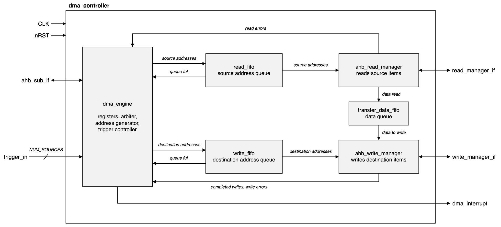

# `dma_controller` specification

| | |
|---|---|
| RTL | `rtl/source/dma_controller.sv` and submodules (from Purdue-SoCET DMA-zing @ `55e0567`) |
| Design owner | Silicon Badgers |
| Version | 1.2 |

## 1. Summary

An AHB DMA controller with `NUM_CHANNELS` channels. Each channel copies once (one-shot), repeats a copy (continuous), or steps through a ring of 2^k items (ring). Ring channels can be paced by trigger lines. Reads and writes use separate AHB manager ports; registers sit on an AHB subordinate port. One level interrupt is high while any channel has `DONE` or `ERROR` set.

## 2. Block diagram

`dma_engine` holds the registers, trigger logic, a round-robin arbiter and the address generator. Addresses go into `read_fifo` and `write_fifo`. `ahb_read_manager` fills `transfer_data_fifo`; `ahb_write_manager` drains it. On a bus error or a restart, every queue drops that channel's entries.

## 3. Parameters

| Parameter | Default | Valid range | Description |
|---|---|---|---|
| `NUM_CHANNELS` | 8 | Power of 2, 2–32 | Channels |
| `NUM_SOURCES` | 32 | Power of 2, 2–128 | Trigger lines |
| `FIFO_DEPTH` | 16 | Power of 2, ≥ 4 | Depth of each queue |
| `DATA_SIZE` | 32 | 32 | Bus width |

Out-of-range values stop elaboration.

## 4. Clocks and resets

| Signal | Description |
|---|---|
| `CLK` | Rising edge. The only clock. |
| `nRST` | Active low, asynchronous assert, synchronous deassert. Resets everything. |

## 5. Ports

| Port | Dir | Width | Reset value | Description |
|---|---|---|---|---|
| `CLK` | in | 1 | — | Clock |
| `nRST` | in | 1 | — | Reset |
| `ahb_sub_if` | — | `ahb_if.subordinate` | `HREADYOUT`=1, `HRESP`=0 | Register port |
| `read_manager_if` | — | `ahb_if.manager` | `HTRANS`=IDLE | Source reads |
| `write_manager_if` | — | `ahb_if.manager` | `HTRANS`=IDLE, `HWSTRB`=0 | Destination writes |
| `trigger_in` | in | `NUM_SOURCES` | — | Trigger lines |
| `dma_interrupt` | out | 1 | 0 | Interrupt |

All bus ports follow AMBA AHB with `HWSTRB`. Protocol rules specific to DMA-zing:

- P1. The register window is `0x9000_1000`–`0x9000_1FFF`.
- P2. The register port accepts a transfer when `HSEL` = 1 and `HTRANS` ≠ IDLE. It has no `HREADY` input.
- P3. Mapped register accesses complete with zero wait states.
- P4. Unmapped offsets, `HADDR[1:0]` ≠ 0, and writes with `HWSTRB` ≠ `1111` get a two-cycle ERROR response.
- P5. Register reads return the whole register at any `HSIZE`.
- P6. Both manager ports drive `HADDR` = the item address rounded down to the item size, and `HSIZE` = the item size. The read port takes the item from its byte lane; the write port marks it with `HWSTRB`.
- P7. With `FIFO_DEPTH` ≥ 8, four queued, consecutive word items of one channel that stay inside one 1 KB block go out as INCR4. Everything else is SINGLE. An INCR4 always runs four beats unless that port gets an ERROR.
- P8. Each manager port pipelines: the next address phase overlaps the current data phase. `HWDATA` and `HWSTRB` hold while a data phase is waited.
- P9. After a write ERROR, the next accepted address phase gets a data phase with `HWSTRB` = `0000`. So does a dropped item whose address phase is accepted after the drop.
- P10. A trigger fires on a rising edge of `trigger_in`. There is no synchronizer.
- P11. `dma_interrupt` = OR over channels of `DONE` | `ERROR`, in the same cycle.

## 6. Register map

Base `0x9000_1000`. With N = `NUM_CHANNELS`:

| Offset | Block | Registers |
|---|---|---|
| `0x10·ch` | Channel control | `SOURCE`, `DESTINATION`, `CONTROL`, `DESIRED_TRANSFERS` |
| `16N + 0x10·ch` | Channel status | `TRANSFERS_COMPLETED`, `TRANSFERS_REMAINING`, `CURRENT_CHANNEL_ACTIVE`, `ERROR_ADDRESS` |
| `32N + 0x8·ch` | Trigger | `TRIGGER_CONFIG`, `TRIGGER_STATUS` |
| Other | — | ERROR |

### 6.1 Channel control (`0x10·ch`)

| Offset | Register | Access | Reset | Description |
|---|---|---|---|---|
| `+0x0` | `SOURCE` | RW | 0 | First source byte address |
| `+0x4` | `DESTINATION` | RW | 0 | First destination byte address |
| `+0x8` | `CONTROL` | below | 0 | Mode, size, steps, run and status bits |
| `+0xC` | `DESIRED_TRANSFERS` | RW | 0 | Items per copy or pass |

### 6.2 `CONTROL`

A write replaces all 32 bits.

| Bits | Field | Access | Reset | Software | Hardware |
|---|---|---|---|---|---|
| 31 | `BUFFER_SEL` | RW | 0 | Ring: 0 source steps, 1 destination steps | — |
| 30:28 | `RING_SIZE` | RW | 0 | Ring pass = 2^`RING_SIZE` items | — |
| 27 | `DONE` | RW, HS | 0 | Write 0 clears | Set at the end of a copy or pass, or on an invalid configuration. Hardware wins |
| 26 | `ERROR` | RW, HS | 0 | Write 0 clears | Set on a bus error. Hardware wins |
| 25 | — | RW | 0 | Reserved: stored, no effect | — |
| 24 | `ABORT` | RW, HC | 0 | Write 1 with `ENABLE`=0 to stop | Cleared once `ENABLE` reads 0 |
| 23:16 | `DEST_INCR` | RW | 0 | Destination step, bytes | — |
| 15:8 | `SOURCE_INCR` | RW | 0 | Source step, bytes | — |
| 7 | `ENABLE` | RW, HC | 0 | Write 1 to start, 0 to stop | Cleared when the last one-shot address is queued, on error, on abort, on an invalid configuration, when armed outside ring mode |
| 6:4 | `MODE` | RW | 0 | 0 one-shot, 1 continuous, 2 ring; 3–7 invalid | — |
| 3:2 | — | RW | 0 | Reserved: stored, no effect | — |
| 1:0 | `SIZE` | RW | 0 | 0 byte, 1 halfword, 2 word; 3 invalid | — |

### 6.3 Channel status (`16N + 0x10·ch`), read-only

| Offset | Register | Reset | Description |
|---|---|---|---|
| `+0x0` | `TRANSFERS_COMPLETED` | 0 | Writes completed this run |
| `+0x4` | `TRANSFERS_REMAINING` | 0 | Items left in the copy or pass |
| `+0x8` | `CURRENT_CHANNEL_ACTIVE` | 0 | `1 << ch` while the channel holds the grant |
| `+0xC` | `ERROR_ADDRESS` | 0 | Byte address of the failed item |

### 6.4 Trigger (`32N + 0x8·ch`)

| Offset | Register | Bits | Field | Access | Reset | Description |
|---|---|---|---|---|---|---|
| `+0x0` | `TRIGGER_CONFIG` | 23:16 | `COUNT` | RW | 1 | Credits per trigger edge |
| | | 7 | `ARM` | RW | 0 | Pace from a trigger line. Writing `ARM`=0 clears `CREDIT` |
| | | log2(`NUM_SOURCES`)−1:0 | `SOURCE_SEL` | RW | 0 | Trigger line |
| | | Other | — | RW | 0 | Reserved: stored, no effect |
| `+0x4` | `TRIGGER_STATUS` | 16 | `OVERRUN` | RO, any write clears | 0 | Credit saturated |
| | | 11:0 | `CREDIT` | RO | 0 | Items the channel may queue |

## 7. Functional description

### 7.1 Programming model

1. Write `SOURCE`, `DESTINATION` and `DESIRED_TRANSFERS`.
2. Write `CONTROL` with `MODE`, `SIZE`, steps and `ENABLE`=1.
3. Wait for `dma_interrupt`. Read `CONTROL` to find `DONE` or `ERROR`.
4. Write `CONTROL` with that bit at 0.

A one-shot channel is running until `DONE` sets, although `ENABLE` reads 0 once its last address is queued.

### 7.2 Modes

| Mode | Addresses | `DONE` | Arbiter grant |
|---|---|---|---|
| One-shot | k < `DESIRED_TRANSFERS` | After the last write | Released after the last address |
| Continuous | Same, repeated | Every pass | Kept until the channel stops |
| Ring | `BUFFER_SEL` side steps through 2^`RING_SIZE` items | Every pass | Released every pass |

### 7.3 Arbitration

Round robin over requesting channels. A channel requests while `ENABLE` = 1 and, if armed, `CREDIT` > 0.

### 7.4 Triggers

An armed ring channel queues one item per credit. Each trigger edge adds `COUNT` credits, saturating at 4095 with `OVERRUN`.

### 7.5 Errors, stops and restarts

- Bus error: the channel stops, sets `ERROR`, records `ERROR_ADDRESS`, and its queued items are dropped. Other channels continue.
- Abort or disable: no new addresses; queued items finish; `DONE` stays 0.
- Restart (`ENABLE`=1 to a stopped channel): items the channel still has queued are dropped and do not count toward the new run.
- Dropped items: up to five reads already on the bus complete and their data is discarded. A write whose address phase was accepted before the drop completes. An ERROR on a dropped item is ignored.

### 7.6 Timing

Cycles after the `CONTROL` write's data phase, zero-wait memories, word items:

| Items | First read | First write | Last write data | `DONE` |
|---|---|---|---|---|
| 1 | +5 | +8 | +9 | +11 |
| 4 | +5 | +8 | +12 | +14 |
| 16 | +5 | +8 | +24 | +26 |

Throughput: one item per cycle per port.

Cycle table, 4-word one-shot, from `verify/dma_probe_tb.sv`:

| Cycle | `ENABLE` | Read address | Read data | Write address | Write data | `DONE` |
|---|---|---|---|---|---|---|
| 0 | 0 | | | | | 0 |
| 1 | 1 | | | | | 0 |
| 2–4 | 1 | | | | | 0 |
| 5 | 1 | `0100` | | | | 0 |
| 6 | 1 | `0104` | `a0a00040` | | | 0 |
| 7 | 0 | `0108` | `a0a00041` | | | 0 |
| 8 | 0 | `010c` | `a0a00042` | `0900` | | 0 |
| 9 | 0 | | `a0a00043` | `0904` | `a0a00040` | 0 |
| 10 | 0 | | | `0908` | `a0a00041` | 0 |
| 11 | 0 | | | `090c` | `a0a00042` | 0 |
| 12 | 0 | | | | `a0a00043` | 0 |
| 13 | 0 | | | | | 0 |
| 14 | 0 | | | | | 1 |

## 8. Requirements

| ID | Requirement |
|---|---|
| R01 | Mapped register accesses shall complete OKAY with zero wait states. |
| R02 | Partial writes, unaligned accesses and unmapped offsets shall get an ERROR response and change nothing. |
| R03 | Reset shall set every register to its Section 6 value and `dma_interrupt` to 0. |
| R04 | Writes to status registers shall change nothing, except that a `TRIGGER_STATUS` write clears `OVERRUN`. |
| R05 | `ENABLE`=1 to an idle channel shall start a run and reset its status registers. |
| R06 | A one-shot run shall move item k from `SOURCE`+k·`SOURCE_INCR` to `DESTINATION`+k·`DEST_INCR`, each exactly once. |
| R07 | `DONE` shall set at the end of every one-shot copy and every continuous or ring pass. |
| R08 | Continuous mode shall repeat the copy until stopped. |
| R09 | Ring mode shall step the `BUFFER_SEL` side through 2^`RING_SIZE` items and wrap. |
| R10 | Byte and halfword items shall change only their own bytes. |
| R11 | Bursts shall follow P7. |
| R12 | `dma_interrupt` shall equal the OR of every channel's `DONE` \| `ERROR`. |
| R13 | A bus error shall stop the channel, set `ERROR`, record `ERROR_ADDRESS` and drop its queued items as in Section 7.5. Other channels continue. |
| R14 | After an error, `ENABLE`=1 shall start a fresh, correct copy. |
| R15 | `ABORT`=1 with `ENABLE`=0 shall stop the channel without `DONE`. |
| R16 | `ENABLE`=0 shall stop a running channel without `DONE`. |
| R17 | `ENABLE`=1 to a running channel shall not restart it. |
| R18 | `MODE` 3–7, `SIZE`=3, or one-shot or continuous with `DESIRED_TRANSFERS`=0, shall set `DONE`, clear `ENABLE` and end the run with no new bus traffic. |
| R19 | The arbiter shall be round robin. A continuous channel keeps the grant until it stops. |
| R20 | An armed ring channel shall queue at most `CREDIT` items. |
| R21 | Arming a non-ring channel shall stop it as `ENABLE`=0 does. |
| R22 | Status registers shall behave as in Section 6.3. |
| R23 | `CURRENT_CHANNEL_ACTIVE` shall read `1 << ch` while the channel holds the grant. |
| R24 | R01–R23 and R26 shall hold for every legal parameter value. Illegal values shall stop elaboration. |
| R25 | With zero-wait memories, an N-word one-shot shall take no longer after bus errors than before them. With `FIFO_DEPTH` ≥ 8 it shall finish within N + 12 cycles. |
| R26 | A restart shall drop the channel's queued items from earlier runs; they shall not count toward the new run. |
| R27 | Both manager ports shall follow P6–P9. |

## 9. Corner cases

| Condition | Behaviour | Ref |
|---|---|---|
| One-shot or continuous with `DESIRED_TRANSFERS`=0 | Invalid: `DONE`, no traffic | R18 |
| `SIZE`=3 | Invalid: `DONE`, no traffic | R18 |
| Misaligned item | Rounded down to its size | AS6 |
| `CONTROL` written as a copy or pass completes | `DONE` still sets | R07 |
| Trigger armed outside ring mode | Channel stops | R21 |
| Software writes `DONE`=1 or `ERROR`=1 | Bit set, interrupt raised | Q2 |
| Burst would cross a 1 KB boundary | Sent as SINGLEs | R11 |
| Error while the channel has items on the bus | Reads complete and are dropped; a write already accepted lands | R13 |
| Channel dropped during a burst | Burst finishes; dropped write beats have `HWSTRB`=`0000` | R27 |
| Restart before old writes land | Old items dropped | R26 |

## 10. Assumptions

| ID | Assumption |
|---|---|
| AS1 | `ahb_sub_if.HCLK`/`HRESETn` are `CLK`/`nRST`. |
| AS2 | `nRST` deasserts synchronously to `CLK`. |
| AS3 | `trigger_in` is synchronous to `CLK`. |
| AS4 | The fabric only selects the register port when `HREADY` is high. |
| AS5 | Memories honour `HWSTRB` and return whole words. |
| AS6 | Items are naturally aligned. |
| AS7 | Software does not change a running channel's addresses, length or `MODE`. |
| AS8 | Software stops a ring channel before disarming it. |

## 11. Known limitations

| ID | Limitation |
|---|---|
| L1 | `CURRENT_CHANNEL_ACTIVE` can stay set after a disable. |
| L2 | No trigger synchronizer. |
| L3 | A continuous channel blocks all others. |
| L4 | Steps are unsigned, 0–255 bytes. |
| L5 | Base address is fixed. |
| L6 | No bursts with `FIFO_DEPTH` = 4. |

## 12. Open questions

| ID | Question | Owner | Answer |
|---|---|---|---|
| Q1 | Unused `CONTROL` and `TRIGGER_CONFIG` bits are stored. Should they read 0? | Design | No. Reserved: stored, no effect. |
| Q2 | Software can set `DONE` and `ERROR`. Intended? | Design | Yes. Software can raise the interrupt. |
| Q3 | A `CONTROL` write in the cycle a copy completes loses `DONE`. | Design | RTL bug. Fixed in 1.2: hardware wins. |
| Q4 | `ENABLE` clears when the last address is queued, before `DONE`. | Design | Intended. Section 7.1. |
| Q5 | Arming a non-ring channel leaves it stuck until `ENABLE`=0 is written. | Design | RTL bug. Fixed in 1.2: the channel stops (R21). |
| Q6 | The docs say sub-word register loads work. They do not. | Design | Doc fix. P4, P5. |
| Q7 | Sub-word transfers use a word-aligned `HADDR`. | Design | RTL bug. Fixed in 1.2 (P6). |
| Q8 | `CURRENT_CHANNEL_ACTIVE` reads 0 for channels ≥ 32. | Design | More than 32 channels is illegal and now stops elaboration. |
| Q9 | Should continuous mode reject `DESIRED_TRANSFERS`=0? | Design | Yes (R18). Fixed in 1.2. |
| Q10 | Should `SIZE`=3 be invalid? | Design | Yes (R18). Fixed in 1.2. |
| Q13 | `ahb_pkg.sv` swaps the `SEQ` and `BUSY` encodings. | Design | Fixed in 1.2. |
| Q14 | After a stop, a queued item that ends a pass still sets `DONE`. | Design | RTL bug. Fixed in 1.2. |
| Q15 | A kill during a waited write changes `HWSTRB` mid data phase. | Design | RTL bug. Fixed in 1.2 (P8). |
| Q16 | A kill cuts an INCR4 short. | Design | RTL bug. Fixed in 1.2 (P7). |
| Q17 | Re-enabling before queued writes land counts them into the new run. | Design | RTL bug. Fixed in 1.2 (R26). |
| Q18 | The write manager's `committed` counter leaks on every kill. | Design | RTL bug. Fixed in 1.2. |
| Q19 | A `CONTROL` write during a held write error loses `ENABLE`. | Design | RTL bug. Fixed in 1.2: the error is one pulse. |
| Q20 | No bursts with `FIFO_DEPTH` < 6. Intended? | Design | Yes. L6. |

## 13. Revision history

| Version | Date | RTL commit | Change |
|---|---|---|---|
| 1.0 | 2026-10-06 | `55e0567` | First version, from `docs/dma.md` and `docs/modules.md` |
| 1.1 | 2026-10-08 | `55e0567` | Q14–Q20 and R25 from the UVM bench |
| 1.2 | 2026-10-08 | — | All questions settled; RTL fixes for Q3, Q5, Q7, Q9, Q10, Q13–Q19 and 1 KB bursts; parameter checks; R26, R27 |
